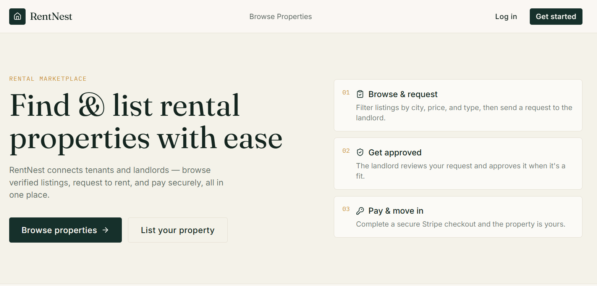

# 🏠 RentNest — Frontend

A rental property marketplace built with Next.js (App Router). Tenants browse and rent properties, landlords list and manage them, and admins oversee users, properties and rentals.

[🌐 Live Site](https://rentnest-frontend-jade.vercel.app) • [⚙️ Live API](https://rentnest-backend-three.vercel.app/api)




## 🛠️ Tech Stack

| Area | Technology |
|---|---|
| Framework | Next.js 16 (App Router), React 19, TypeScript |
| Styling | Tailwind CSS v4 |
| Data fetching | TanStack Query |
| Forms & validation | React Hook Form + Zod |
| Notifications | Sonner |
| Payment | Stripe Checkout (hosted session created by the backend) |
| Deployment | Vercel |

## ✨ Core Features

- 🔐 Register as a **Tenant** or **Landlord**, with an **Admin** role seeded in the backend
- 🛡️ Role-based route protection and redirects using `middleware.ts` and session cookies
- 🏘️ Public property listing and property details pages
- 🧑‍💼 Landlord dashboard: add, edit and delete properties, and manage rental requests
- 🧑‍🤝‍🧑 Tenant dashboard: rental requests and payment flow
- 💳 Stripe Checkout payment with success and cancel pages
- 🛠️ Admin dashboard: manage users, properties and rentals
- ✅ Form validation with Zod and toast feedback on every action

## 📦 Dependencies

**Production:** next, react, react-dom, @tanstack/react-query, react-hook-form, @hookform/resolvers, zod, sonner, lucide-react, date-fns, clsx, tailwind-merge

**Development:** typescript, tailwindcss, @tailwindcss/postcss, eslint, eslint-config-next, @types/node, @types/react, @types/react-dom

## 🚀 Run Locally

**Prerequisites:** Node.js 18+, npm, and the RentNest backend running locally (or use the live API).

1. Clone the repository
   ```bash
   git clone https://github.com/aflazur/rentnest-frontend.git
   ```
2. Go to the project folder
   ```bash
   cd rentnest-frontend
   ```
3. Install dependencies
   ```bash
   npm install
   ```
4. Create your environment file
   ```bash
   cp .env.example .env
   ```
5. Fill in `.env`
   ```env
   NEXT_PUBLIC_API_BASE_URL=http://localhost:5000/api
   NEXT_PUBLIC_SITE_URL=http://localhost:3000
   ```
   To use the deployed backend instead, set `NEXT_PUBLIC_API_BASE_URL=https://rentnest-backend-three.vercel.app/api`.
6. Start the dev server and open http://localhost:3000
   ```bash
   npm run dev
   ```

For Stripe redirects to work, the backend's `FRONTEND_URL` must point to this app. See [API_INTEGRATION.md](./API_INTEGRATION.md) for the full flow.

## 🗂️ Project Structure

```
src/
  app/          routes (auth, properties, dashboard/tenant|landlord|admin, payment)
  components/   auth, properties, dashboard, layout, ui
  hooks/        TanStack Query hooks per resource
  lib/          API client, session helpers, Zod schemas, utils
  types/        shared TypeScript types
  middleware.ts role-based route protection
```

## 🔗 Links

| | |
|---|---|
| Live frontend | https://rentnest-frontend-jade.vercel.app |
| Live backend | https://rentnest-backend-three.vercel.app/api |
| Backend repo | <add your backend repo link here> |

## 👨‍💻 Author

**Aflazur Rahaman** — Full Stack Web Developer
GitHub: [@aflazur](https://github.com/aflazur)